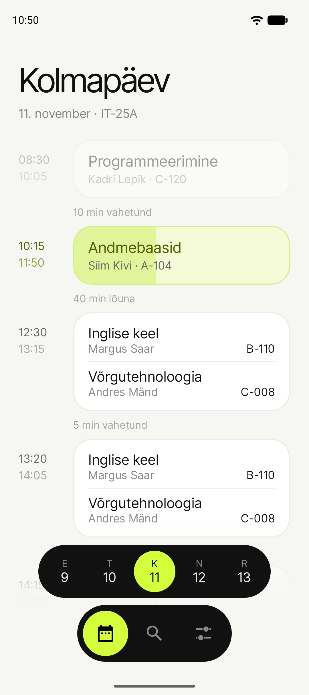
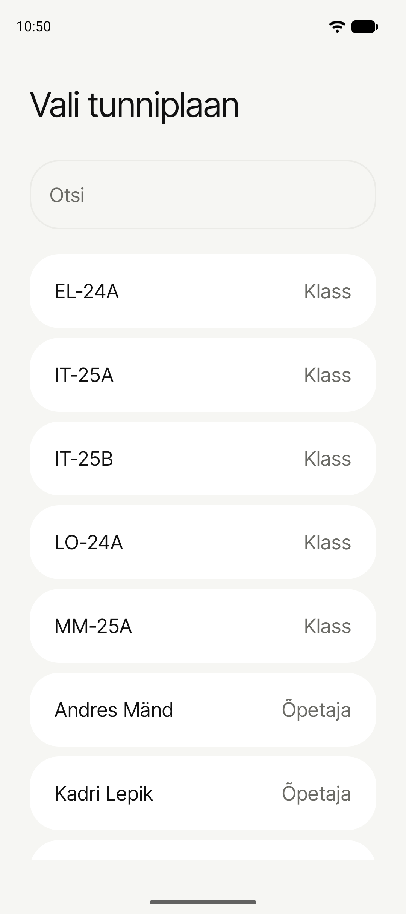
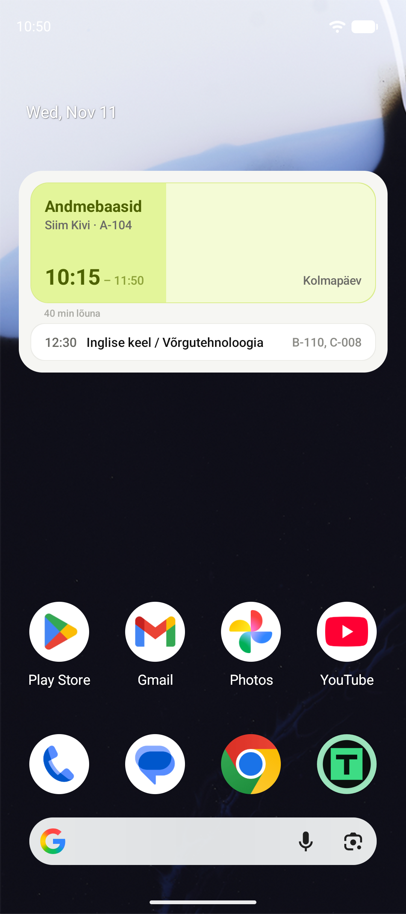
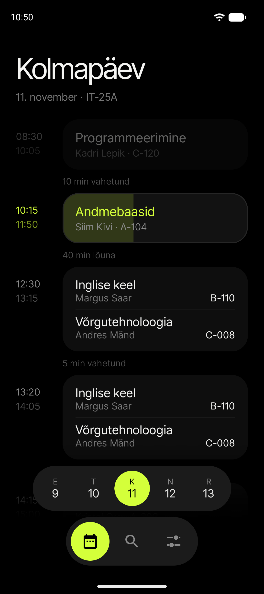
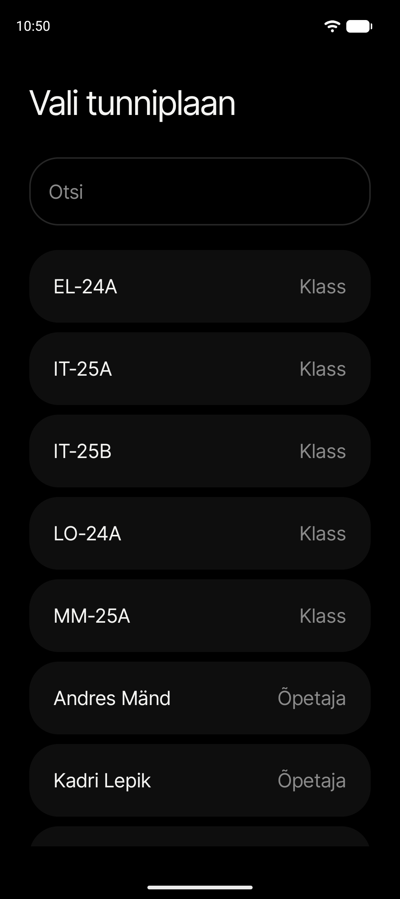
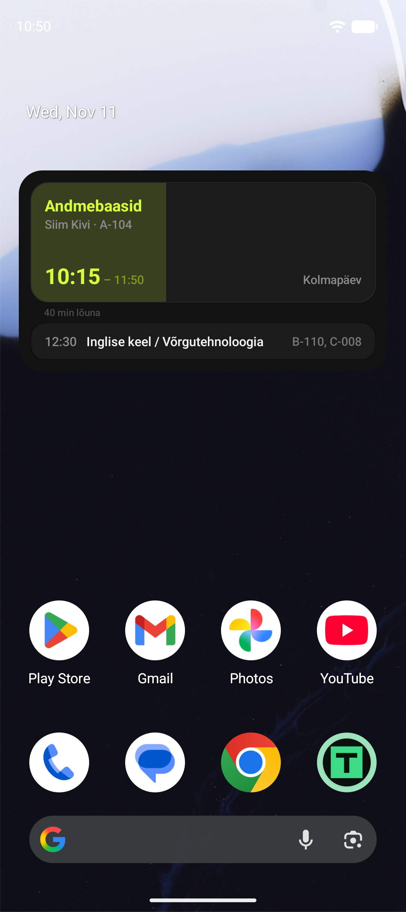

<div align="center">

# Techno tunniplaan

**Your Kesklinna Techno timetable on your phone.**

The app downloads the timetable for your class, teacher or room from EduPage, keeps it
on the phone for when you are offline and shows the next lessons in a home screen widget.


[Eesti](README.md)

| Timetable | Select timetable | Widget |
|:-:|:-:|:-:|
|  |  |  |
|  |  |  |

<sub>Screenshots use an invented timetable.</sub>

</div>

## What it does

- Shows each day's lessons with times, rooms, teachers and breaks. Swipe to change the day.
- Browse has the timetable of every class, teacher and room. Pin the ones you check often.
- The last downloaded timetable stays on the phone, so it opens without internet.
- Light and dark theme, in Estonian, English and Russian.

## Install

1. On your phone, open the [latest release](https://github.com/M4stas/techno-tunniplaan/releases/latest).
2. Download `techno-tunniplaan-1.0.0.apk`.
3. Open the downloaded file. If Android asks, allow your browser to install apps.
4. Tap **Install**, then **Open**.
5. Pick your class or teacher. To view a room's timetable, open **Browse** after setup.

Install a new version the same way, over the old one. Updates signed with the same
key preserve your settings. A release cannot replace a debug build signed with a different key.

## Add the widget

1. Long-press an empty spot on the home screen and choose **Widgets**.
2. Find **Techno tunniplaan** and drag **Next lessons** onto the home screen.
3. Choose how many lessons it shows.

The widget shows the next lesson, its room and when it starts or ends. When two groups
have lessons at the same time, it shows both. You can resize it.

## For developers

You need JDK 21 and the Android SDK.

```sh
git clone https://github.com/M4stas/techno-tunniplaan.git
cd techno-tunniplaan
./gradlew assembleDebug
```

The APK is written to `app/build/outputs/apk/debug/`. See
[docs/branching.md](docs/branching.md) for branches and releases.
