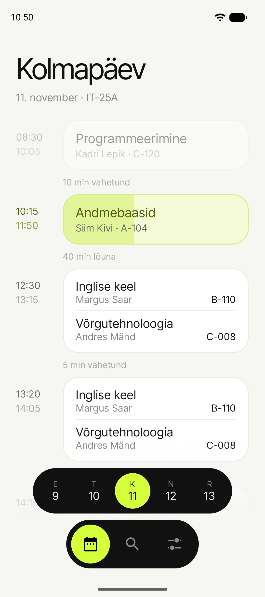
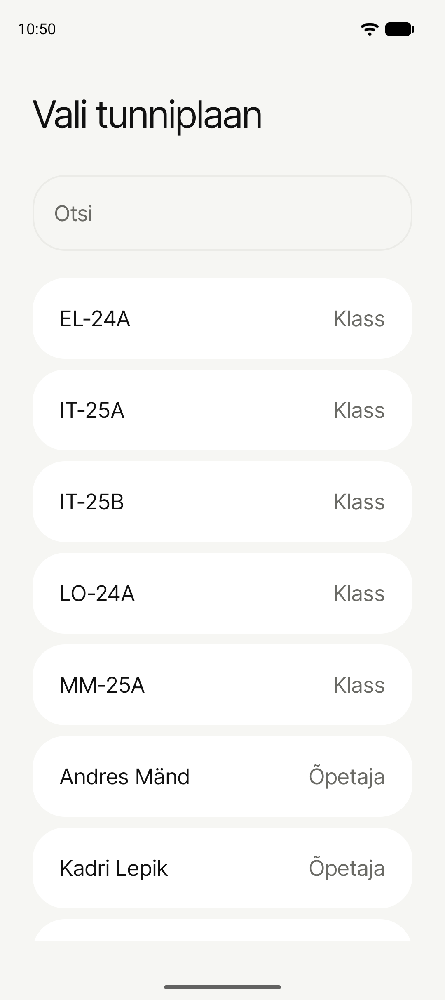
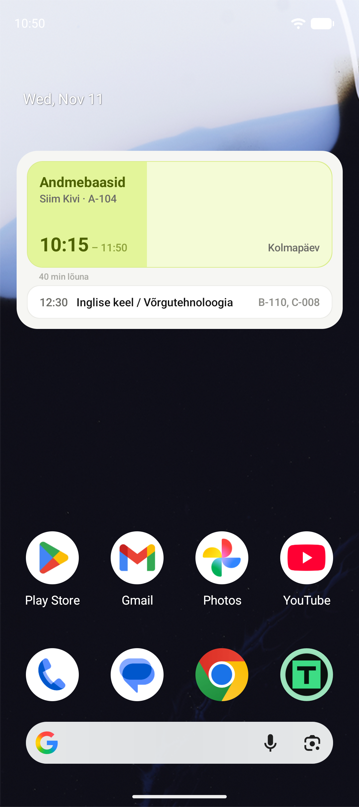
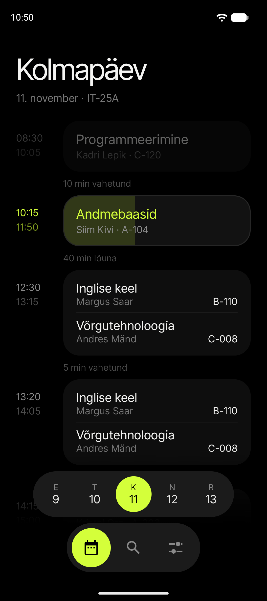
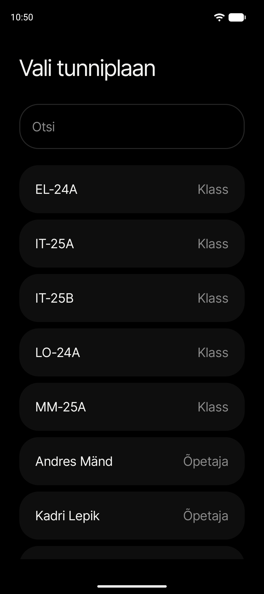
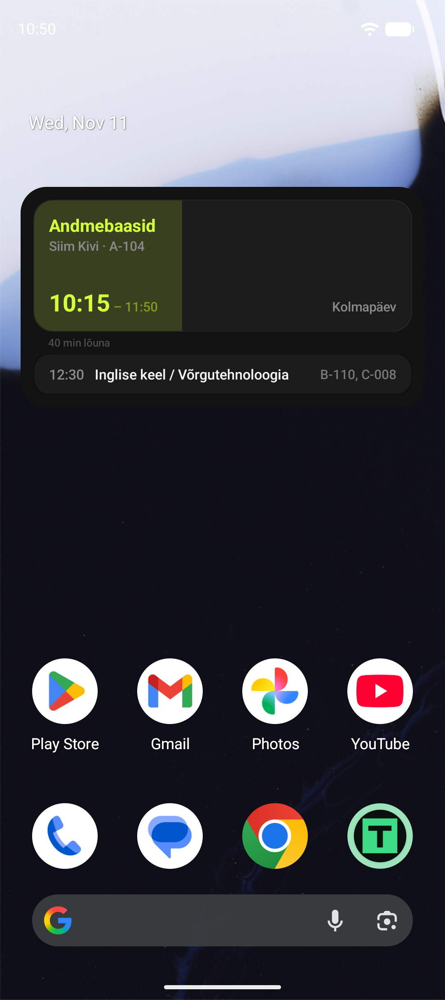

<div align="center">

# Techno tunniplaan

**Kesklinna Techno tunniplaan sinu telefonis.**

Rakendus laadib EduPage'ist sinu klassi, õpetaja või ruumi tunniplaani, hoiab selle
telefonis ka ilma internetita ja näitab järgmisi tunde avaekraani vidinas.


[English](README.en.md)

| Tunniplaan | Vali tunniplaan | Vidin |
|:-:|:-:|:-:|
|  |  |  |
|  |  |  |

<sub>Pildid on tehtud väljamõeldud tunniplaaniga.</sub>

</div>

## Mida rakendus teeb

- Näitab päeva tunde koos aegade, ruumide, õpetajate ja vahetundidega. Päevade vahel liigud pühkides.
- Sirvi vaatest leiad iga klassi, õpetaja ja ruumi tunniplaani. Sagedamini vaadatud saad lemmikuks lisada.
- Viimati laaditud tunniplaan jääb telefoni, nii et see avaneb ka ilma internetita.
- Hele ja tume teema, eesti, inglise ja vene keel.

## Paigaldamine

1. Ava telefonis [viimane väljalase](https://github.com/M4stas/techno-tunniplaan/releases/latest).
2. Laadi alla fail `techno-tunniplaan-1.0.0.apk`.
3. Ava allalaaditud fail. Kui Android küsib, luba brauseril rakendusi paigaldada.
4. Vajuta **Paigalda** ja seejärel **Ava**.
5. Vali oma klass või õpetaja. Ruumi tunniplaani vaatamiseks ava pärast seadistamist **Sirvi**.

Uue versiooni paigaldad samamoodi vana peale. Seaded jäävad alles.

## Vidina lisamine

1. Vajuta pikalt avaekraani tühjale kohale ja vali **Vidinad**.
2. Otsi üles **Techno tunniplaan** ja lohista **Järgmised tunnid** avaekraanile.
3. Vali, mitu tundi vidin näitab.

Vidin näitab järgmist tundi, ruumi ja seda, millal tund algab või lõpeb. Kui kahel
rühmal on samal ajal tund, näitab vidin mõlemat. Vidina suurust saab muuta.

## Arendajale

Vaja on JDK 21 ja Android SDK-d.

```sh
git clone https://github.com/M4stas/techno-tunniplaan.git
cd techno-tunniplaan
./gradlew assembleDebug
```

APK tekib kausta `app/build/outputs/apk/debug/`. Harud ja väljalasked on kirjeldatud
failis [docs/branching.md](docs/branching.md).
